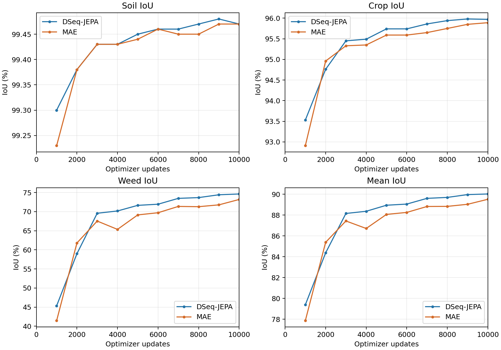

# DSeq-JEPA 与 MAE 统一农业微调对照

本次受控比较中，DSeq-JEPA的mIoU高0.51个百分点、Weed IoU高1.44个百分点，小组件召回高2.63个百分点。MAE的weed像素precision高0.70个百分点。当前证据支持暂时保留DSeq-JEPA作为本项目主baseline，同时保留MAE作为正式受控参照；尚不足以声称稳定跨seed优势。

| 指标 (%) | DSeq-JEPA | MAE | DSeq − MAE (百分点) |
|---|---:|---:|---:|
| Soil IoU | 99.47 | 99.47 | 0.00 |
| Crop IoU | 95.97 | 95.89 | +0.08 |
| Weed IoU | 74.62 | 73.18 | +1.44 |
| mIoU | 90.02 | 89.51 | +0.51 |

两个best都在10000 updates，由相同772张val、官方round2百分比mIoU严格改进规则选择；最后均完整恢复best并另做官方评价。数值是验证集选择结果，不是独立test结果。差值按官方显示百分数计算，极小差异受0.01个百分点显示精度影响。

| 杂草度量 | DSeq-JEPA | MAE | DSeq − MAE |
|---|---:|---:|---:|
| 小组件召回 (%) | 44.8276 | 42.1960 | +2.6316 pp |
| 召回数 / GT组件数 | 494 / 1102 | 465 / 1102 | +29 |
| Pixel precision (%) | 88.4015 | 89.0998 | −0.6983 pp |
| Pixel recall (%) | 82.7191 | 80.3799 | +2.3393 pp |
| Weed→Soil (pixels) | 547,960 | 587,001 | −39,041 |
| Weed→Crop (pixels) | 191,094 | 252,096 | −61,002 |

小组件严格定义为GT weed四连接区域≤100像素、预测weed覆盖≥50%，并非真实植株实例。DSeq少漏分100,043个GT weed像素，但多误报43,601个weed像素。总体平均值上的0.51个百分点主要由weed差异贡献，soil几乎不变，crop差异很小。高召回对漏检敏感的应用有价值，MAE较少误报的取舍也应保留。

| 更新数 | DSeq mIoU | MAE mIoU | DSeq Weed IoU | MAE Weed IoU |
|---:|---:|---:|---:|---:|
| 1000 | 79.39 | 77.87 | 45.35 | 41.47 |
| 2000 | 84.37 | 85.38 | 58.98 | 61.79 |
| 3000 | 88.15 | 87.43 | 69.57 | 67.53 |
| 4000 | 88.36 | 86.71 | 70.17 | 65.35 |
| 5000 | 88.94 | 88.06 | 71.64 | 69.14 |
| 6000 | 89.05 | 88.25 | 71.94 | 69.71 |
| 7000 | 89.60 | 88.82 | 73.47 | 71.36 |
| 8000 | 89.69 | 88.83 | 73.67 | 71.29 |
| 9000 | 89.96 | 89.03 | 74.41 | 71.77 |
| 10000 | 90.02 | 89.51 | 74.62 | 73.18 |

DSeq在10个采样点中9个mIoU更高，MAE在2000步短暂领先。首次观测达到88% mIoU为DSeq3000步、MAE5000步；达到89%为DSeq6000步、MAE9000步；90%只有DSeq在10000步达到。评价间隔1000步，这些是首次观测节点，不能给出精确阈值穿越时间。MAE4000步出现真实回落，随后继续提高；不删除该节点，也没有为MAE调整schedule或延长训练。重复观察同一val曲线不是独立重复实验。

两者的逐图weed IoU在有weed的738张图上相关0.9275，共同漏分weed657,306像素。共同困难较多，但图像05-26_00242中MAE的weed IoU高11.16个百分点，而两个06-05密集叶片病例由DSeq表现更好。完整真实图和像素错误记录见 [错误分析](s2_error_analysis.md)。

公平控制包括同一ViT-B/16/MaskedVisionTransformer路径、neck/UPerNet/aux、PhenoBench成员与增强、loss、effective batch16、AdamW/LR/WD/poly/warmup、BF16/activation checkpoint、10000更新、seed20261110、滑窗与官方评价。两个模型均126,907,910参数，126,756,614可训练；90项neck/head初始state与S1固定启动代码重建状态逐张量相等。历史S1没有step-zero独立存档，故证据是重建状态与实际S2初始化相等，不能称直接检查历史S1初始存档。详见 [架构与初始化审计](s2_model_equivalence.md)。

两组allocator峰值3.5138/3.5214 GiB接近；训练及10次val墙钟分别3.3767/4.5090小时。MAE前4000步0.8895s/update接近S1平均0.8683，后6000步1.4902；实时记录了其他GPU1任务启动。设备共享与I/O使墙钟和板卡能耗不能归因为预训练初始化本身，详见 [成本报告](s2_compute_cost.md)。

科学归因范围是“DSeq-JEPA与MAE预训练checkpoint在统一农业微调协议下的迁移性能比较”。原始自监督方法、预训练数据曝光和训练预算没有完全控制，不支持“JEPA潜在预测目标因果优于MAE像素重建目标”的结论。一条DSeq和一条MAE轨迹也不能证明不同下游seed或不同预训练seed上的稳定统计优势。

下一步明确优先为两种初始化追加同一个不同的有监督训练seed，保持现协议，以复核差值方向和召回/precision取舍；本轮未执行该复验。复验若保持DSeq的weed与小组件优势，再进入CropAndWeed外部田间验证。若方向反转或差异接近波动，应将两者并列并重新评估主baseline；本次没有MAE胜出的证据，不需要立即切换主baseline。单一小杂草适配改进应在基线复验后开展，避免把初始化波动误当作改进收益。

来源：冻结 [S1官方结果](s1_official_metrics.json)、真实 [S2官方结果](s2_official_metrics.json)、同一GT/原始预测整数统计，以及 [官方MAE来源](https://github.com/facebookresearch/mae/blob/efb2a8062c206524e35e47d04501ed4f544c0ae8/README.md)。
