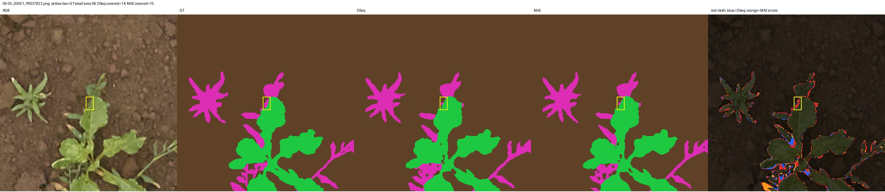
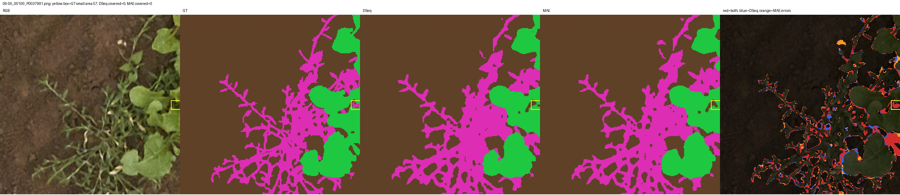
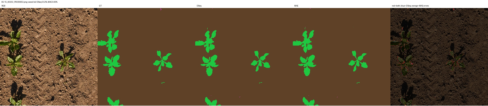
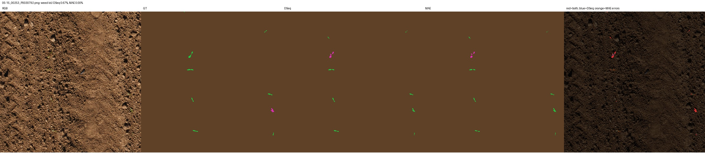
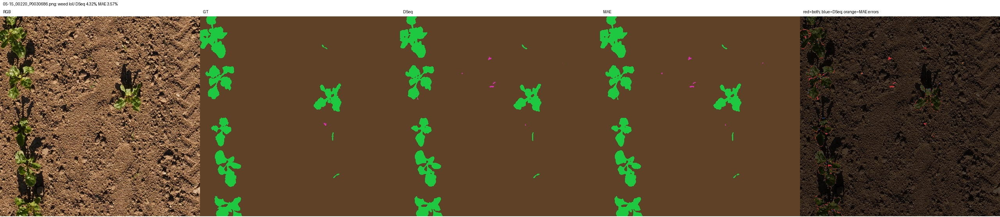
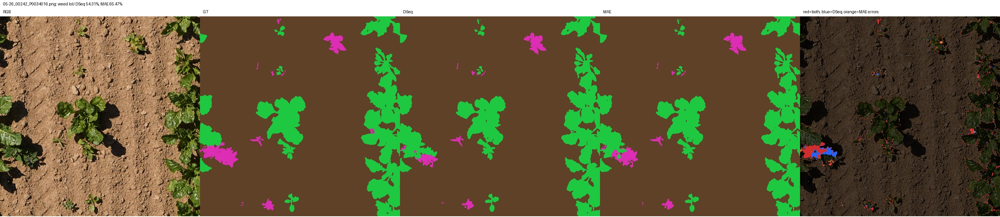
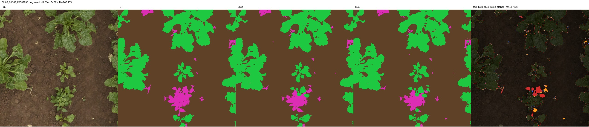
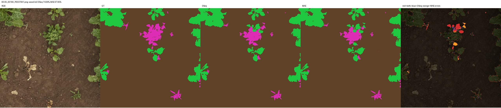
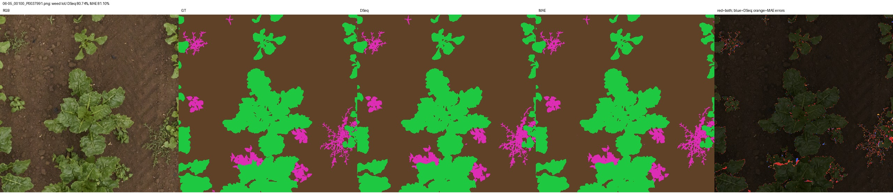
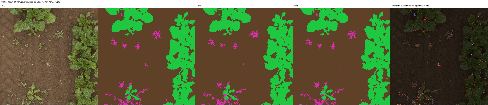

# S2 同图农业误差分析

DSeq 的总体 Weed IoU、像素 recall 和小组件召回更高，MAE 的像素 precision 更高。差异来自漏分与误报的取舍，不能概括成每张图都由 DSeq 获胜。

| 度量 | DSeq-JEPA | MAE | DSeq − MAE |
|---|---:|---:|---:|
| 小组件召回 (%) | 44.8276 | 42.1960 | +2.6316 pp |
| 召回组件 / GT组件 | 494 / 1102 | 465 / 1102 | +29 |
| Weed pixel precision (%) | 88.4015 | 89.0998 | −0.6983 pp |
| Weed pixel recall (%) | 82.7191 | 80.3799 | +2.3393 pp |
| Weed TP (pixels) | 3,537,657 | 3,437,614 | +100,043 |
| Weed FP (pixels) | 464,149 | 420,548 | +43,601 |
| Weed FN (pixels) | 739,054 | 839,097 | −100,043 |
| Weed→Soil (pixels) | 547,960 | 587,001 | −39,041 |
| Weed→Crop (pixels) | 191,094 | 252,096 | −61,002 |

严格复用 S1 定义：GT weed 的四连接区域面积≤100像素、其中≥50%被预测为weed即召回。连通组件不等于真实独立植株实例。全部772张、同一GT及原图坐标参与统计，没有按图平均代替全量像素 precision/recall。

全量配对中，共同错误3,505,028像素，仅DSeq错603,190，仅MAE错666,884；预测标签不一致1,295,085像素。共同错误占较大部分，且772/772张均有共同错误像素。738张有GT weed的图像全部存在共同weed漏分，另外34张无GT weed仍保留在官方772张评价中。

共同weed漏分657,306像素，仅DSeq漏分81,748，仅MAE漏分181,791。738张有weed图像的逐图weed IoU Pearson相关0.9275，表明困难图像排序相近；这只是描述统计，不能当作独立植株、独立随机种子或统计显著性的证明。

当前全部772张DSeq原预测的GT weed像素数、TP/FP/FN、Weed→Soil/Crop逐图整数统计与冻结S1 CSV一致；MAE原预测也与复用分析脚本产生的CSV逐图一致。详细配对记录见 [s2_paired_image_errors.csv](s2_paired_image_errors.csv) 和 [s2_paired_error_summary.json](s2_paired_error_summary.json)。

病例选图固定为S1六个worst_cases，再按S1漏召回小组件数量选择两张；没有根据MAE表现选图。下表均由原始预测计算。RGB、GT、DSeq、MAE和错误叠图已经直接查看，未调用外部识图API，也没有使用生成图片。

| 相同图像 | Weed IoU：DSeq / MAE (%) | Weed FN：DSeq / MAE | 观察 |
|---|---:|---:|---|
| 05-15_00202_P0030953 | 0.52 / 0.00 | 124 / 125 | 强投影阴影和土壤颗粒背景中，两者几乎都漏掉稀少weed |
| 05-15_00253_P0030792 | 0.67 / 0.00 | 343 / 348 | 稀疏幼苗中GT weed被预测成crop；两者共同失败 |
| 05-15_00220_P0030686 | 4.32 / 3.57 | 94 / 98 | 作物间的微小weed大量被漏成soil，两者还有weed误报 |
| 05-26_00242_P0034016 | 54.31 / 65.47 | 9,710 / 6,965 | MAE更好保留左侧与crop相邻的weed区域 |
| 06-05_00145_P0037991 | 74.38 / 68.13 | 8,501 / 11,040 | 中下部GT weed团块中，两者都有crop混淆，MAE混淆更多 |
| 06-05_00166_P0037991 | 74.06 / 67.95 | 8,407 / 10,872 | 相似密集叶片区域，MAE同样漏成crop更多 |
| 06-05_00100_P0037991 | 80.74 / 81.10 | 4,260 / 3,968 | MAE略高，但指定微小组件两者均完全漏分 |
| 06-05_00051_P0037822 | 77.90 / 77.92 | 2,965 / 3,276 | IoU接近；MAE误报更少、漏分更多，逐图组件召回为7/12对6/12 |

05-26_00242 是必须保留的反例：MAE将weed误成crop的像素从DSeq的7,837降到5,158，Weed IoU高11.16个百分点。图上左侧crop边缘旁的品红区域，DSeq较多预测为绿色crop，MAE恢复其中一部分。不能由总体领先推出所有作物/杂草相邻情形都由DSeq处理得更好。

06-05_00145 与00166的RGB中都有大片crop叶片和较密集的weed叶片。中部GT为weed的一些叶片被两者识别成crop；MAE的Weed→Crop分别为8,649和8,405，DSeq为6,280和6,253。红色共同错误与橙色MAE独有错误在这些区域相邻分布，支持“共同困难之外，MAE在这两例增加了crop混淆”的局部描述。

微小weed、细长叶缘和复杂土壤背景仍是共同困难。两张局部放大图用黄色框标出被统计的确切GT组件，坐标与覆盖整数保存在JSON中：00051的58像素组件分别覆盖14和15像素，均未达50%；00100的57像素组件两者均覆盖0像素。细枝/叶缘上两者都出现断裂、轮廓偏差和填充GT间隙的错误，整体IoU较高也不保证小组件被召回。

错误叠图红=两者都错、蓝=仅DSeq错、橙=仅MAE错；棕=soil、绿=crop、品红=weed。全图预览缩至512×512，局部256×256放大至512×512；所有数值仍在原1024×1024标签上计算，预览JPEG不参与评价。

阴影、相邻叶片及细叶缘是直接看图得到的病例描述。没有这些条件的人工分层标注，不能报告阴影/遮挡子集精度，也不能将差异归因为阴影或遮挡导致的因果机制。选定困难病例也不能替代全772张结果。

来源：真实RGB/GT、两种best-val原始预测、冻结 [S1逐图记录](s1_per_image_errors.csv)、复用 `scripts/agriculture/analyze_errors.py` 和新增配对统计脚本。
