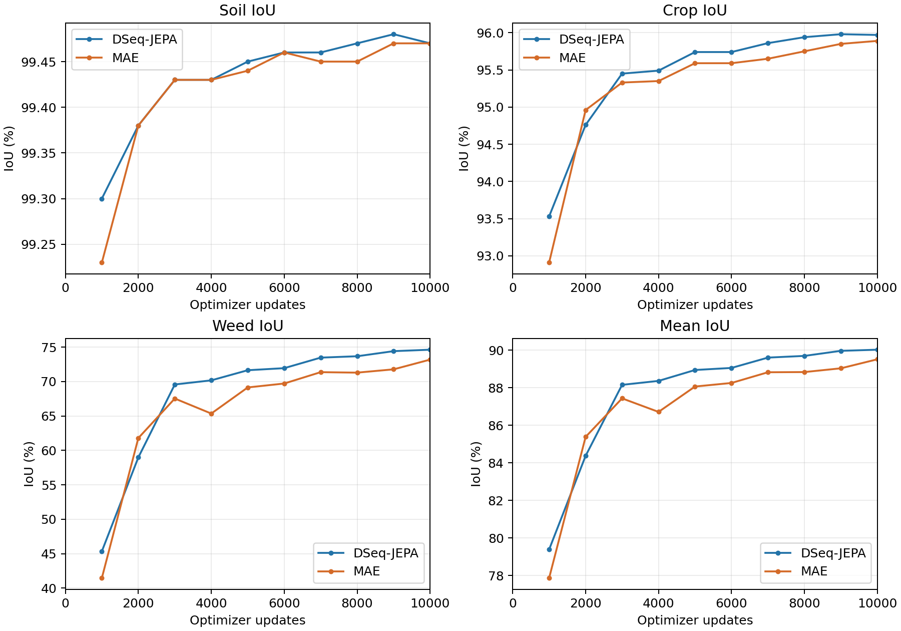
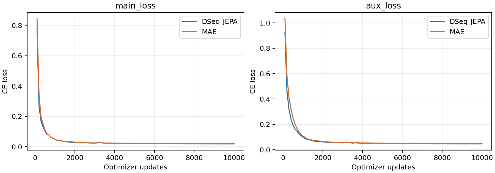

# S2 MAE真实训练结果

TRAINING_COMPLETE：10000/10000 optimizer updates，80000 microbatches，有效batch16；逐步日志连续、10次完整val已验证。
best-val step10000、mIoU89.51%；最终严格恢复best并重新输出772/772张1024×1024单通道预测，ID仅0/1/2，官方phenobench-eval --task semantics输出保存在run/metrics。

| 指标(%) | DSeq-JEPA | MAE | DSeq − MAE(百分点) |
|---|---:|---:|---:|
| soil | 99.47 | 99.47 | +0.00 |
| crop | 95.97 | 95.89 | +0.08 |
| weed | 74.62 | 73.18 | +1.44 |
| mIoU | 90.02 | 89.51 | +0.51 |

| 更新数 | DSeq mIoU | MAE mIoU | DSeq Weed IoU | MAE Weed IoU |
|---:|---:|---:|---:|---:|
| 1000 | 79.39 | 77.87 | 45.35 | 41.47 |
| 2000 | 84.37 | 85.38 | 58.98 | 61.79 |
| 3000 | 88.15 | 87.43 | 69.57 | 67.53 |
| 4000 | 88.36 | 86.71 | 70.17 | 65.35 |
| 5000 | 88.94 | 88.06 | 71.64 | 69.14 |
| 6000 | 89.05 | 88.25 | 71.94 | 69.71 |
| 7000 | 89.6 | 88.82 | 73.47 | 71.36 |
| 8000 | 89.69 | 88.83 | 73.67 | 71.29 |
| 9000 | 89.96 | 89.03 | 74.41 | 71.77 |
| 10000 | 90.02 | 89.51 | 74.62 | 73.18 |

权重大小/完整SHA见s2_checkpoint_manifest.json；正式启动代码、config/pretrain/data哈希见s2_run_provenance.json，最终best及772预测证据见s2_evaluation_provenance.json。
曲线是val选择过程，不是独立test，也没有多seed置信区间。
来源：真实正式日志、官方指标JSON和全量预测；[官方PhenoBench评价实现](https://github.com/PRBonn/phenobench/blob/0edc128ef7f67c8c6577554c7d1a2e382e2ea81f/src/phenobench/evaluation/evaluate_semantics.py)。
